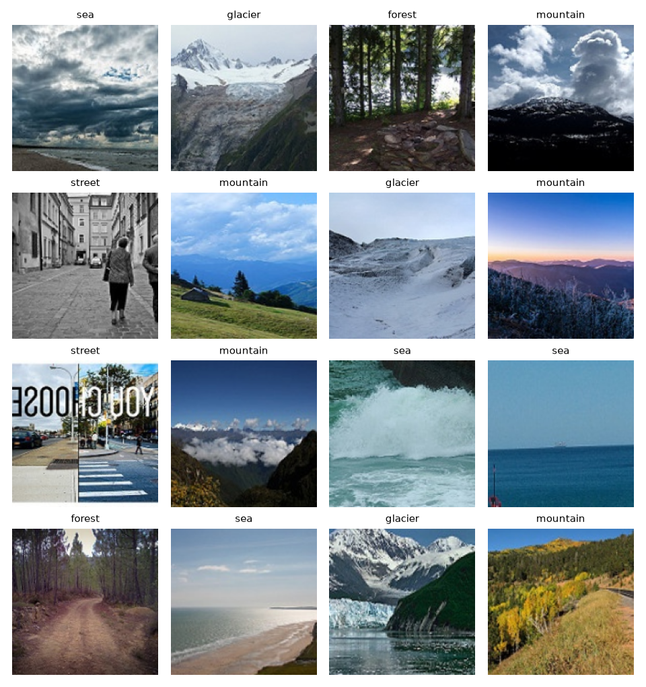
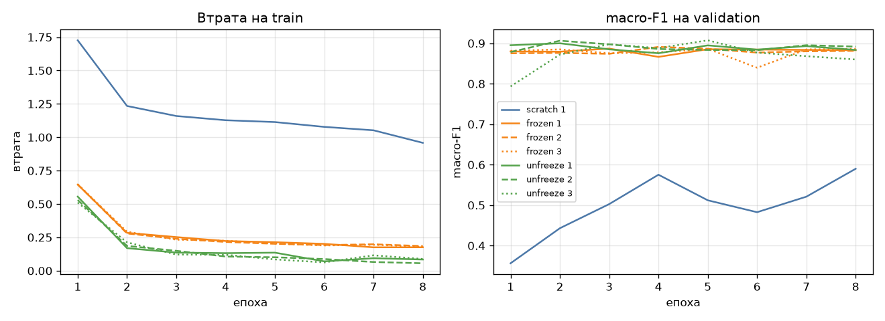
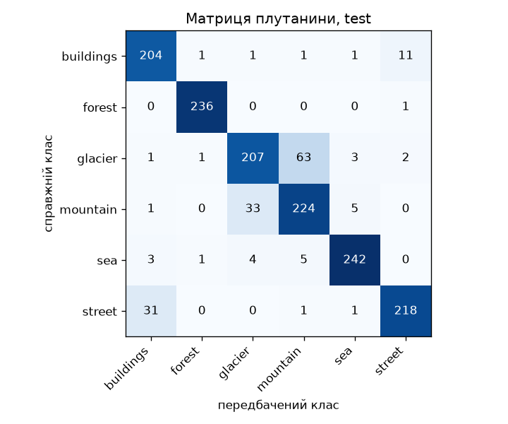
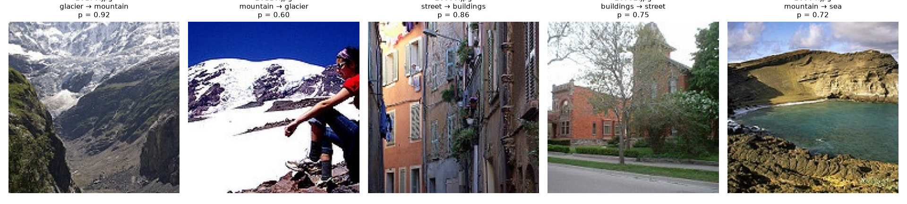

# ЛР3. Обчислювальний експеримент і трансферне навчання

Мета: порівняти три режими навчання ResNet-18 на малій вибірці за однакового обчислювального бюджету й відповісти, яку частину виграшу дають попередньо навчені ознаки ($\Delta_{\mathrm{pre}}$), яку — донавчання кістяка ($\Delta_{\mathrm{unf}}$) і чи більша кожна з цих різниць за розкид між запусками.

Набір: [Intel Image Classification](https://www.kaggle.com/datasets/puneet6060/intel-image-classification) (потрібен обліковий запис Kaggle): 6 класів, `seg_train` — 14 034 і `seg_test` — 3 000 зображень. Папку `seg_pred` не використовуємо. Набір у репозиторій не додано.

## Запуск

Потрібні лише [`uv`](https://docs.astral.sh/uv/getting-started/installation/), локальна копія набору (папка, що містить `seg_train` і `seg_test`) та інтернет під час першого запуску `train.py`: ваги ImageNet (`ResNet18_Weights.IMAGENET1K_V1`) torchvision завантажує сам і кешує. Команди однакові для Windows, macOS і Linux; виконуються з папки `lab3/`. Замість `python`/`python3` (назва залежить від ОС) використовується `uv run python`. Пристрій для навчання (CUDA, MPS або CPU) обирається автоматично; test оцінюється на CPU.

```bash
uv sync
# 1. Навчання: поділ, перевірки, сім запусків, вибір і збереження lab3_model.pt
uv run python train.py --data path/to/intel
# 2. Аналіз: таблиці, криві, ефекти, одноразова оцінка на test
uv run python analysis.py --data path/to/intel
```

`path/to/intel` замініть на свій шлях. Приклади: `~/Downloads/intel` (macOS/Linux), `C:/Users/<користувач>/Downloads/Intel`.

| Файл                        | Призначення                                                                                        |
| --------------------------- | -------------------------------------------------------------------------------------------------- |
| `common.py`                 | Спільний код: поділ, дані, модель, режими, метрики, правило вибору                                 |
| `train.py`                  | Перевірки пунктів 1–2, сім запусків, журнали, вибір і збереження `lab3_model.pt`                   |
| `analysis.py`               | Перевірка хешу, таблиця, криві, ефекти, перевірка вибору, test, матриця плутанини, п'ять помилок   |
| `pyproject.toml`, `uv.lock` | Залежності та їхні зафіксовані версії                                                              |
| `split.csv`                 | Поділ: `file`, `label`, `part`                                                                     |
| `runs/`                     | `<режим>_seed<зерно>/run.json` і `val_logits.npy` усіх семи запусків (ваги запусків не комітяться) |
| `lab3_model.pt`             | Вибрана модель: `state_dict`, `regime`, `seed`, `classes`, `img_size`                              |
| `results/`                  | `checks.md`, `batch.png`, `curves.png`, `confusion.png`, `errors.png`, `report.md`                 |

`results/checks.md` містить таблиці пунктів 1–2, `results/report.md` — пунктів 3–5 із поточного запуску `analysis.py`; числа нижче скопійовано звідти. Середовище навчального запуску: Windows (AMD64), CPU, torch 2.15.0, torchvision 0.29.2, NumPy 2.5.5, scikit-learn 1.9.1, Matplotlib 3.11.2, Pillow 13.0.0 (версії зафіксовано в `uv.lock`); версія Python, хеш коміту й назва пристрою — у `runs/*/run.json`.

## Дані, поділ і налаштування

Поділ будується за процедурою завдання (`make_split` у `common.py`), після чого всі дані читаються лише з `split.csv`.

1. Для кожного класу список імен файлів відсортований як рядки.
2. train: `rng = np.random.default_rng(0)` один раз для всіх класів у порядку `buildings … street`; для класу з $n_k$ файлами `idx = np.arange(n_k)`, `rng.shuffle(idx)`, у train йдуть `idx[:200]` (разом 1200).
3. validation і test: новий `np.random.default_rng(0)`, для кожного класу з `seg_test` `rng.shuffle(idx)`, `cut = n_k // 2`; `idx[:cut]` — validation, `idx[cut:]` — test.

`split.csv` записується з однаковим символом кінця рядка (`\n`) на всіх ОС, тому SHA-256 файлу збігається між платформами.

| Частина          | Перетворення                                                                                                  |
| ---------------- | ------------------------------------------------------------------------------------------------------------- |
| train            | `RandomResizedCrop(160, scale=(0.7, 1.0))` → `RandomHorizontalFlip()` → `ToTensor()` → `Normalize(mean, std)` |
| validation, test | `Resize((160, 160))` → `ToTensor()` → `Normalize(mean, std)`                                                  |

$\mathrm{mean} = (0.485, 0.456, 0.406)$, $\mathrm{std} = (0.229, 0.224, 0.225)$ — статистики ImageNet, однакові для всіх режимів.

| Режим      | Ваги      | Що навчається  | Параметрів, що навчаються | Групи AdamW                                        | У `eval()` під час навчання       |
| ---------- | --------- | -------------- | ------------------------- | -------------------------------------------------- | --------------------------------- |
| `scratch`  | випадкові | уся мережа     | 11 179 590                | усі, $3\cdot 10^{-3}$                              | —                                 |
| `frozen`   | ImageNet  | `fc`           | 3 078                     | `fc`, $3\cdot 10^{-3}$                             | `conv1`, `bn1`, `layer1`–`layer4` |
| `unfreeze` | ImageNet  | `layer4`, `fc` | 8 396 806                 | `fc`, $3\cdot 10^{-3}$; `layer4`, $3\cdot 10^{-4}$ | `conv1`, `bn1`, `layer1`–`layer3` |

Решта налаштувань: `AdamW(weight_decay=1e-4)`, `CrossEntropyLoss`, `float32`, 8 епох по 38 кроків (разом 304), train: `batch_size=32`, `shuffle=True`, `drop_last=False`; validation і test: `batch_size=64`, `shuffle=False`; `num_workers=0`. Без розкладів швидкості навчання, обрізання градієнта, змішаної точності, згладжування міток, зважування класів, ранньої зупинки та вибору епохи за validation. Повний список — у `runs/*/run.json`.

## 1. Перевірки до навчання

Результати: `results/checks.md`. Навчання не починається, якщо будь-яка перевірка пунктів 1–2 не збіглася з очікуваним.

**Поділ.** Кількість зображень / сума числових імен файлів:

| Клас      | train             | validation        | test              |
| --------- | ----------------- | ----------------- | ----------------- |
| buildings | 200 / 1 996 761   | 218 / 4 837 323   | 219 / 4 837 559   |
| forest    | 200 / 2 032 625   | 237 / 5 276 962   | 237 / 5 291 326   |
| glacier   | 200 / 2 183 923   | 276 / 6 135 652   | 277 / 6 157 250   |
| mountain  | 200 / 1 950 345   | 262 / 5 789 535   | 263 / 5 849 765   |
| sea       | 200 / 1 987 613   | 255 / 5 655 068   | 255 / 5 668 011   |
| street    | 200 / 1 841 817   | 250 / 5 541 845   | 251 / 5 547 533   |
| Разом     | 1200 / 11 993 084 | 1498 / 33 236 385 | 1502 / 33 351 444 |

Усі 18 клітинок збігаються з контрольною таблицею завдання. Жоден файл не входить у дві частини (імена файлів унікальні в усьому `split.csv`).

**Пакет після перетворень.** Перші 16 зображень навчального пакета (після аугментацій, з оберненим нормуванням і міткою над кожним): `results/batch.png`. Кольори природні, мітки відповідають вмісту; у третьому рядку зображення вулиці з дзеркальним написом показує, що віддзеркалення застосовано.



**Початкова втрата.** Модель за кроками 1–5 зі зерном 1, перший навчальний пакет, `set_train_mode` і `torch.no_grad()`, до жодного кроку оптимізатора. Крос-ентропія для логітів $z$ і правильного класу $c$: $p=\mathrm{softmax}(z)$, $L = -\ln p_c = -z_c + \ln\sum_k e^{z_k}$ (усереднюється за пакетом). Для моделі, що дає всім $C=6$ класам однакову ймовірність $p_k = 1/C$, $L_0 = -\ln\frac{1}{C} = \ln C = \ln 6 \approx 1{,}792$.

| Режим     | $L_0$  | $\ln 6$ |
| --------- | ------ | ------- |
| `scratch` | 2.1344 | 1.7918  |
| `frozen`  | 2.2155 | 1.7918  |

Обидві втрати вищі за $\ln 6$ на $0{,}34$ і $0{,}42$. Це очікувано, а не помилка: випадково ініціалізована модель дає не рівні, а розкидані логіти, і для логітів з незалежним розкидом із дисперсією $\sigma^2$ середня втрата приблизно дорівнює $\ln 6 + \tfrac{5}{12}\sigma^2$ (наближення для помірних $\sigma$). Звідси $\sigma\approx 0{,}9$–$1{,}0$ для обох режимів. У `frozen` відхилення дещо більше: невід'ємні ознаки ImageNet після `avgpool` подаються на випадково ініціалізований `fc`, а BN кістяка працює зі збереженими статистиками ImageNet. Різниця між режимами мала: у обох режимах `fc` ініціалізується однаково (стандартна ініціалізація `Linear`).

## 2. Перевірка режимів навчання

Кожна перевірка починається з нового екземпляра моделі за кроками 1–5 зі зерном 1; ці моделі не оцінюються на validation і не входять у таблицю пункту 3.

**Параметри.** Кількість — сума `numel()`.

| Режим      | Усього     | `requires_grad=True` | Групи оптимізатора (параметрів при швидкості навчання)                     | Заморожений параметр в оптимізаторі |
| ---------- | ---------- | -------------------- | -------------------------------------------------------------------------- | ----------------------------------- |
| `scratch`  | 11 179 590 | 11 179 590           | усі: 11 179 590 при $3\cdot 10^{-3}$                                       | ні                                  |
| `frozen`   | 11 179 590 | 3 078                | `fc`: 3 078 при $3\cdot 10^{-3}$                                           | ні                                  |
| `unfreeze` | 11 179 590 | 8 396 806            | `fc`: 3 078 при $3\cdot 10^{-3}$; `layer4`: 8 393 728 при $3\cdot 10^{-4}$ | ні                                  |

Числа збігаються з таблицею режимів завдання.

**Що змінюється під час навчання.** Копія `state_dict()` (параметри й буфери), `set_train_mode`, 5 кроків на перших 5 пакетах (у режимі `train()` BN оновлює ковзні статистики як $\hat\mu \leftarrow (1-m)\hat\mu + m\mu_B$, $\hat\sigma^2 \leftarrow (1-m)\hat\sigma^2 + m\sigma_B^2$, $m=0{,}1$; у `eval()` — не оновлює), порівняння кожного модуля верхнього рівня через `torch.equal`. Очікування: у модулях зі стовпця «У `eval()`» не змінилося ні те, ні інше; в решті змінилися параметри, а в тих, що містять BN, — і ковзні статистики.

| Режим      | Модуль   | Параметри змінилися | Статистики BN змінилися | Збігається з очікуваним |
| ---------- | -------- | ------------------- | ----------------------- | ----------------------- |
| `frozen`   | `conv1`  | ні                  | немає BN                | так                     |
| `frozen`   | `bn1`    | ні                  | ні                      | так                     |
| `frozen`   | `layer1` | ні                  | ні                      | так                     |
| `frozen`   | `layer2` | ні                  | ні                      | так                     |
| `frozen`   | `layer3` | ні                  | ні                      | так                     |
| `frozen`   | `layer4` | ні                  | ні                      | так                     |
| `frozen`   | `fc`     | так                 | немає BN                | так                     |
| `unfreeze` | `conv1`  | ні                  | немає BN                | так                     |
| `unfreeze` | `bn1`    | ні                  | ні                      | так                     |
| `unfreeze` | `layer1` | ні                  | ні                      | так                     |
| `unfreeze` | `layer2` | ні                  | ні                      | так                     |
| `unfreeze` | `layer3` | ні                  | ні                      | так                     |
| `unfreeze` | `layer4` | так                 | так                     | так                     |
| `unfreeze` | `fc`     | так                 | немає BN                | так                     |

**Дослід із навмисною помилкою.** Режим `frozen`, але `model.train()` замість `set_train_mode`.

Прогноз (записано до запуску): параметри кістяка не зміняться, бо вони мають `requires_grad=False` і не передані оптимізатору. Ковзні `running_mean` і `running_var` усіх шарів BN кістяка зміняться, бо BN у режимі `train()` оновлює їх у кожному прямому проході (`momentum=0.1`, за 5 кроків ковзне середнє зсувається приблизно на $1-(1-m)^5 = 1-0{,}9^5 \approx 41\,\%$ від статистик ImageNet до статистик пакетів). Крива втрати на train цього не покаже: втрата знижується, бо `fc` навчається нормально. Наслідок проявиться лише в `eval()`: validation нормується зсунутими статистиками.

Результат: параметри кістяка не змінилися (`conv1`, `bn1`, `layer1`–`layer4`: «ні»), а статистики BN змінилися в `bn1` і `layer1`–`layer4` (у правильному режимі — у жодному). Для `layer1.0.bn1` після 5 кроків $\max|\Delta\,\mathrm{running\_mean}| = 0{,}0886$, $\max|\Delta\,\mathrm{running\_var}| = 0{,}1484$.

Чому `requires_grad=False` не захищає ці значення: ковзні статистики — це буфери, а не параметри. Вони оновлюються в прямому проході BN у режимі `train()`, а не через градієнт і оптимізатор, тому прапорець `requires_grad` на них не діє. Захищає лише `eval()`. Для `layer4` у режимі `unfreeze` оновлення статистик правильне: `layer4` донавчається, його входи й активації змінюються разом з вагами, і BN має підлаштуватися під нові дані, а не лишатися на статистиках ImageNet.

## 3. Сім запусків

| #   | Режим      | Зерно | Втрата train, епоха 8 | macro-F1 validation, епоха 8 | Час навчання, с |
| --- | ---------- | ----- | --------------------- | ---------------------------- | --------------- |
| 1   | `scratch`  | 1     | 0.9581                | 0.5900                       | 380             |
| 2   | `frozen`   | 1     | 0.1759                | 0.8829                       | 214             |
| 3   | `frozen`   | 2     | 0.1848                | 0.8814                       | 200             |
| 4   | `frozen`   | 3     | 0.1788                | 0.8864                       | 200             |
| 5   | `unfreeze` | 1     | 0.0841                | 0.8836                       | 234             |
| 6   | `unfreeze` | 2     | 0.0560                | 0.8918                       | 234             |
| 7   | `unfreeze` | 3     | 0.0882                | 0.8600                       | 231             |

macro-F1 рахується для кожного класу проти решти, потім усереднюється:

$$
\mathrm{F1}_k = \frac{2\,TP_k}{2\,TP_k + FP_k + FN_k}, \qquad \text{macro-F1} = \frac{1}{6}\sum_{k=0}^{5}\mathrm{F1}_k.
$$

Криві втрати на train і macro-F1 на validation за епохами, усі сім запусків на спільних осях: `results/curves.png`.



Спостереження за кривими: `scratch` за 8 епох не зійшовся (втрата 0,96 і ще знижується, macro-F1 коливається в межах 0,36–0,59 і немонотонний). У `frozen` і `unfreeze` macro-F1 виходить на 0,87–0,91 уже з 1–2 епохи, далі коливається в межах кількох сотих; одиничні провали (`frozen` зерно 3, епоха 6: 0,8396; `unfreeze` зерно 3, епоха 1: 0,7934) показують, що значення однієї епохи шумне. Втрата на train у `unfreeze` (0,056–0,088) приблизно вдвічі нижча, ніж у `frozen` (0,176–0,185), проте macro-F1 на validation не вищий.

Журнали (`runs/<режим>_seed<зерно>/run.json`) містять зерно й усі налаштування, хеш коміту та позначку про незакомічені зміни, SHA-256 `split.csv`, версії Python, PyTorch і torchvision, назву пристрою, втрату на train і macro-F1 на validation за кожну епоху, час навчання. Хеш `split.csv` починається з `d3a611aec41f` (повний — у журналах); він однаковий у всіх семи журналах і збігається з поточним файлом (`analysis.py` перевіряє це й зупиняється з помилкою за розбіжності). Усі сім запусків зроблено одним викликом `train.py`, тому код і поділ у них однакові.

Час навчання вимірюється для всього циклу, разом з оцінкою на validation після кожної епохи; запуски виконано на CPU.

## 4. Розклад ефектів

$$
\bar F_r = \frac{1}{3}\sum_{s=1}^{3} F_{r,s}, \qquad R_r = \max_s F_{r,s} - \min_s F_{r,s}, \qquad R = \max(R_{\mathrm{frozen}},\, R_{\mathrm{unfreeze}}),
$$

$$
\Delta_{\mathrm{pre}} = \bar F_{\mathrm{frozen}} - F_{\mathrm{scratch},1}, \qquad
\Delta_{\mathrm{unf}} = \bar F_{\mathrm{unfreeze}} - \bar F_{\mathrm{frozen}}, \qquad
\Delta_{\mathrm{pre}} + \Delta_{\mathrm{unf}} = \bar F_{\mathrm{unfreeze}} - F_{\mathrm{scratch},1}.
$$

| Величина                                             | Значення       |
| ---------------------------------------------------- | -------------- |
| $\bar F_{\mathrm{frozen}},\ R_{\mathrm{frozen}}$     | 0.8836, 0.0051 |
| $\bar F_{\mathrm{unfreeze}},\ R_{\mathrm{unfreeze}}$ | 0.8785, 0.0318 |
| $R$                                                  | 0.0318         |
| $\Delta_{\mathrm{pre}}$                              | +0.2936        |
| $\Delta_{\mathrm{unf}}$                              | −0.0051        |

$\Delta_{\mathrm{pre}} + \Delta_{\mathrm{unf}} = +0{,}2885$ — повний виграш трансферу відносно `scratch` (зерно 1).

Правило, окремо для кожного ефекту: якщо $|\Delta| \le R$, різниця не відрізняється від розкиду (результату немає); якщо $|\Delta| > R$, ефект вартий перевірки, але не доведений.

- $\Delta_{\mathrm{pre}}$: $|\Delta_{\mathrm{pre}}| = 0{,}2936 > R = 0{,}0318$ (приблизно $9{,}2R$): ефект вартий перевірки, але не доведений.
- $\Delta_{\mathrm{unf}}$: $|\Delta_{\mathrm{unf}}| = 0{,}0051 \le R$ (приблизно $0{,}16R$): різниця не відрізняється від розкиду; результату немає.

**Що саме змінює зерно.** У всіх режимах — випадкову послідовність перемішування train і випадкові аугментації (обрізання, віддзеркалення), тобто порядок і вміст пакетів. У `frozen` і `unfreeze` ваги кістяка однакові (ImageNet), тому зерно додатково задає лише ініціалізацію `fc`. У `scratch` зерно задає ще й ініціалізацію всієї мережі. Розкид у `frozen` і `unfreeze` різний: $R_{\mathrm{frozen}} = 0{,}0051$ проти $R_{\mathrm{unfreeze}} = 0{,}0318$. У `frozen` оптимізується лише лінійний шар на фіксованих ознаках, і траєкторія слабко залежить від порядку пакетів; в `unfreeze` змінюється 8,4 млн параметрів, і результат після фіксованих 8 епох чутливіший до порядку пакетів. Це підтверджують криві: `unfreeze` зерно 3 після піку 0,9074 на епосі 5 завершує на 0,8600, і саме він формує $R_{\mathrm{unfreeze}}$. Причину розбіжності цього запуску окремо не досліджено.

**Чому $R$ не характеризує розкид запуску 1.** $R$ виміряно на режимах `frozen` і `unfreeze` (запуски 2–7), де ваги кістяка однакові й від зерна залежить лише `fc` та порядок даних. У `scratch` зерно змінює ще й ініціалізацію всієї мережі, а $F_{\mathrm{scratch},1}$ — одне значення без оцінки розкиду. Крива запуску 1 показує, що його розкид, імовірно, значно більший за $R$: macro-F1 між сусідніми епохами змінюється на $0{,}03$–$0{,}09$ (наприклад, 0,5753 на епосі 4, 0,4827 на епосі 6, 0,5900 на епосі 8), і значення епохи 8 є лише одним із таких коливань. Це не змінює висновку щодо $\Delta_{\mathrm{pre}}$: навіть найкраще значення `scratch` за всі епохи (0,59) лежить значно нижче за найгірше значення `frozen` за всі епохи (0,84). Це лише додаткова перевірка: за протоколом береться епоха 8, а формальний вердикт залишається за правилом $|\Delta|>R$.

**Чому правило $|\Delta|>R$ консервативне.** Нехай $F_{r,s}$ за різних зерен мають стандартне відхилення $\sigma$. Для трьох нормально розподілених значень $\mathbb{E}[R_r]\approx 1{,}69\,\sigma$, а стандартна похибка різниці двох середніх із трьох запусків $\sigma\sqrt{2/3}\approx 0{,}82\,\sigma$. Отже, правило в середньому вимагає різниці понад дві стандартні похибки. Водночас сам розмах із трьох значень дуже неточний ($\mathrm{SD}(R_r)\approx 0{,}89\,\sigma$), тому для ефекту, близького до $R$, вердикт нестійкий. Це груба оцінка шуму, а не довірчий інтервал. Наші ефекти далеко від межі: $\Delta_{\mathrm{pre}}\approx 9R$ і $\Delta_{\mathrm{unf}}\approx 0{,}16R$.

**Чи однаковий бюджет за часом.** За кроками бюджет однаковий (304 кроки оптимізатора, 1200 зображень на епоху), за часом — ні. Середній час: `scratch` 380 с, `frozen` 205 с, `unfreeze` 233 с, тобто `scratch` повільніший за `frozen` приблизно у 1,85 раза, а `unfreeze` — на 14 %. Причина в різній вартості зворотного проходу: у `frozen` градієнти рахуються лише для `fc`, в `unfreeze` — додатково через `layer4`, у `scratch` — через усю мережу, зокрема найдорожчі шари з великою просторовою роздільністю. Прямий прохід коштує однаково в усіх режимах, а в час входить і оцінка на validation після кожної епохи.

## 5. Вибір конфігурації і тестова оцінка

**Вибір — лише за validation.** Конфігурація — режим із найбільшим $\bar F_r$ (для `scratch` — його єдине значення $F_{\mathrm{scratch},1}$); серед запусків цього режиму — запуск з найбільшим $F_{r,s}$. Правило реалізовано функцією `select` у `common.py` і від test не залежить.

Середнє $F$ за режимами: `scratch` 0.5900, `frozen` 0.8836, `unfreeze` 0.8785. Вибрано: `frozen`, зерно 3, $F = 0{,}8864$. `lab3_model.pt` відповідає правилу вибору за журналами (перевіряє `analysis.py`). Оскільки $|\Delta_{\mathrm{unf}}| \le R$, вибір між `frozen` і `unfreeze` визначив шум: різниця середніх $0{,}0051$ приблизно вшестеро менша за $R$, а вибір зерна всередині `frozen` теж спирається на різницю $0{,}0035$–$0{,}0050$ між запусками. Процедура від цього не змінюється.

**Test — один раз і лише в `analysis.py`.** `train.py` test не читає. Повторний запуск `analysis.py` лише відтворює ті самі числа й не використовується для зміни режиму, запуску, гіперпараметрів чи кількості епох. Оцінка на CPU, у порядку рядків `split.csv`.

Accuracy $p = \frac{1}{n}\sum_i \mathbb 1[\hat y_i = y_i]$ (сума діагоналі матриці плутанини, поділена на $n$); macro-F1 на test рахується за тією самою формулою, що й на validation. Стандартна похибка $\sqrt{p(1-p)/n}$ — біноміальна, для accuracy (не для macro-F1).

| macro-F1 на test | macro-F1 на validation | Різниця (test − validation) | Accuracy $p$ | $\sqrt{p(1-p)/n}$, $n=1502$ |
| ---------------- | ---------------------- | --------------------------- | ------------ | --------------------------- |
| 0.8892           | 0.8864                 | +0.0028                     | 0.8862       | 0.0082                      |

Вибір найкращого з трьох запусків робить validation-оцінку оптимістичною: це максимум із кількох шумних значень. У наших числах зміщення непомітне, а знак різниці навіть протилежний (test вищий на $0{,}0028$). Причини: (1) очікуване зміщення відбору мале, бо три запуски `frozen` майже збігаються (розкид $R_{\mathrm{frozen}} = 0{,}0051$), тож максимум із них лише трохи вищий за типове значення; (2) validation (1498 зображень) і test (1502 зображення) — різні вибірки, і похибка вибірки $0{,}0082$ приблизно втричі більша за виміряну різницю, тобто різниця $+0{,}0028$ — шум, а не ознака того, що модель на test працює краще. Тому за такого розкиду випадковий склад вибірок легко перекриває зміщення відбору й змінює його знак.

**Confusion матриця** (рядки — справжній клас, стовпці — передбачений): `results/confusion.png`.

| справжній \ передбачений | buildings | forest | glacier | mountain | sea | street |
| ------------------------ | --------- | ------ | ------- | -------- | --- | ------ |
| buildings                | 204       | 1      | 1       | 1        | 1   | 11     |
| forest                   | 0         | 236    | 0       | 0        | 0   | 1      |
| glacier                  | 1         | 1      | 207     | 63       | 3   | 2      |
| mountain                 | 1         | 0      | 33      | 224      | 5   | 0      |
| sea                      | 3         | 1      | 4       | 5        | 242 | 0      |
| street                   | 31        | 0      | 0       | 1        | 1   | 218    |



З 1502 зображень правильно класифіковано 1331 (accuracy 0,8862), помилок 171. Понад 80 % помилок (138 із 171) припадає на дві пари класів: `glacier` ↔ `mountain` (63 + 33 = 96) і `street` ↔ `buildings` (31 + 11 = 42). Найгірша повнота у `glacier` (207 / 277 ≈ 0,75), найкраща у `forest` (236 / 237 ≈ 0,996).

**П'ять характерних помилок.** П'ять найчастіших пар (справжній клас, передбачений клас) поза діагоналлю; за однакової кількості — за зростанням індексу справжнього, потім передбаченого класу. Для кожної пари — перший за іменем (як рядок) файл test із такою помилкою.

| Файл      | Справжній клас | Передбачений клас | Імовірність передбаченого класу | Кількість таких помилок у test |
| --------- | -------------- | ----------------- | ------------------------------- | ------------------------------ |
| 20179.jpg | glacier        | mountain          | 0.9199                          | 63                             |
| 20116.jpg | mountain       | glacier           | 0.5996                          | 33                             |
| 20353.jpg | street         | buildings         | 0.8640                          | 31                             |
| 20752.jpg | buildings      | street            | 0.7497                          | 11                             |
| 20304.jpg | mountain       | sea               | 0.7211                          | 5                              |

Імовірність — $p_{\hat c} = \mathrm{softmax}(z)_{\hat c}$ для логітів $z$ цього зображення на test, де $\hat c$ — передбачений клас. Рисунок: `results/errors.png`.



Категорії (сцена містить обидва класи; ймовірна помилка розмітки; помилка моделі на однозначному зображенні):

- `20179.jpg` (glacier → mountain, $p=0{,}92$): сцена містить обидва класи, бо у кадрі язик льодовика серед скелястих зелених гірських схилів.
- `20116.jpg` (mountain → glacier, $p=0{,}60$): сцена містить обидва класи, бо засніжений гірський пік можна віднести і до гір, і до льодовика; помірна ймовірність це відображає.
- `20353.jpg` (street → buildings, $p=0{,}86$): сцена містить обидва класи, бо вузька вулиця майже повністю заповнена фасадами будинків.
- `20752.jpg` (buildings → street, $p=0{,}75$): сцена містить обидва класи, бо поруч із цегляною будівлею на передньому плані видно дорогу.
- `20304.jpg` (mountain → sea, $p=0{,}72$): сцена містить обидва класи, бо скелястий пагорб огинає затока з морем, яке займає значну частину кадру.

Жодну з п'яти помилок не можна однозначно віднести до помилки моделі на однозначному зображенні, але це висновок із п'яти найчастіших за типом, а не випадкових прикладів; про частку помилок із розмітки чи неоднозначних сцен у всьому test він нічого не каже. Плутанину `glacier` ↔ `mountain` називаємо властивістю набору й не «виправляємо».

## 6. Висновок

**$\Delta_{\mathrm{pre}}$ (ефект попередньо навчених ознак).** Напрям: позитивний, попередньо навчені ознаки покращують macro-F1. Величина: $+0{,}2936$, майже 29 пунктів macro-F1 ($\bar F_{\mathrm{frozen}} = 0{,}8836$ проти $F_{\mathrm{scratch},1} = 0{,}5900$). Співвідношення з розкидом: $|\Delta_{\mathrm{pre}}| = 0{,}2936$ приблизно у $9{,}2$ раза більше за $R = 0{,}0318$, тож за правилом ефект вартий перевірки, але не доведений: $R$ виміряно на інших режимах, а розкид `scratch` оцінити за одним запуском неможливо.

**$\Delta_{\mathrm{unf}}$ (ефект розморожування `layer4`).** Напрям: від'ємний, але за величиною неістотний. Величина: $-0{,}0051$, тобто близько пів пункту macro-F1 ($\bar F_{\mathrm{unfreeze}} = 0{,}8785$ проти $\bar F_{\mathrm{frozen}} = 0{,}8836$). Співвідношення з розкидом: $|\Delta_{\mathrm{unf}}| \approx 0{,}16R$, тобто різниця не відрізняється від розкиду; результату немає. Розморожування `layer4` суттєво знизило втрату на train (приблизно вдвічі), але не покращило macro-F1 на validation, і за наявними запусками причину встановити не можна.

Обидва ефекти виміряно за конкретного бюджету в 304 кроки; з довшим навчанням `scratch` міг би скоротити відставання (його втрата на кінці ще знижується), тож $\Delta_{\mathrm{pre}}$ не переноситься на довше навчання. Для нової задачі з 200 зображеннями на клас я взяв би режим `frozen`: його macro-F1 не відрізняється від `unfreeze` у межах розкиду, розкид між запусками найменший ($R_{\mathrm{frozen}} = 0{,}0051$ проти $0{,}0318$), навчається лише 3 078 параметрів, а час навчання коротший (205 с проти 233 с).

## Джерела

README підготовлено за допомогою генеративного інструмента (Claude); код `common.py`, `train.py` і `analysis.py` було виправлено з його допомогою. Набір даних: [Intel Image Classification (Kaggle)](https://www.kaggle.com/datasets/puneet6060/intel-image-classification). Ваги ImageNet: `torchvision.models.ResNet18_Weights.IMAGENET1K_V1`.
